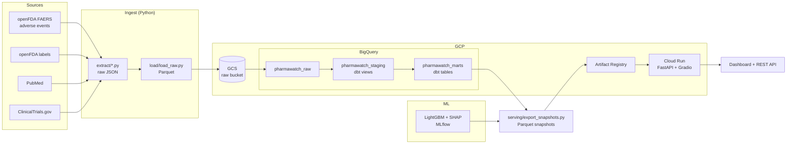
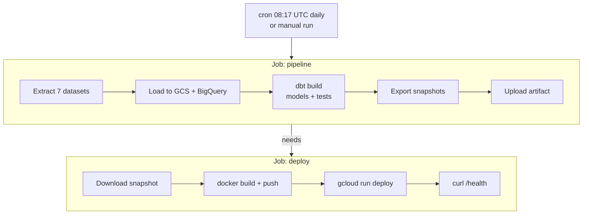

# PharmaWatch

**A drug-safety dashboard built for business readers, not clinicians.** PharmaWatch turns four public data sources into per-drug safety scorecards, trends over time, an emerging-signals watchlist and a risk simulator, rebuilt daily and served from a single Cloud Run app on GCP.

**Live app:** https://pharmawatch-api-595795276542.us-central1.run.app  (API docs at `/docs`)

---

## Architecture



### Daily automation (GitHub Actions)



Both jobs authenticate to GCP with **Workload Identity Federation**: no service-account keys are stored in GitHub. The pipeline and the deployer use separate service accounts with least-privilege roles.

## What the dashboard shows

| Tab | Answers |
|---|---|
| Overview | Which drugs and reactions stand out across the whole portfolio? |
| Drug deep dive | Scorecard for one drug: report volume, serious share, top reactions, strongest signals, recent research and trials |
| Trends over time | Monthly reports, serious reports, serious share, hospitalizations and deaths since 2018, with multi-drug selection |
| Compare drugs | Side-by-side view of two or more drugs |
| Severity simulator | Estimated chance a report is serious for a given profile (age, sex, weight, reaction), with SHAP drivers |
| Methodology | Plain-language definitions and limitations |

Disproportionality statistics (PRR / ROR) are translated into evidence labels: *Notable* (lower bound >= 5), *Strong* (>= 10), *Very strong* (>= 20).

## Data model

| Layer | Objects |
|---|---|
| Raw (`pharmawatch_raw`) | `faers`, `faers_counts`, `faers_windows`, `faers_monthly`, `openfda_labels`, `pubmed_articles`, `clinicaltrials_studies` |
| Staging (`pharmawatch_staging`) | One cleaned `stg_*` view per source, plus the `excluded_reactions` seed |
| Marts (`pharmawatch_marts`) | `mart_safety_signals` (PRR/ROR), `mart_drug_profile`, `mart_emerging_signals`, `mart_risk_features`, `mart_monthly_trends` |

dbt runs tests on every build (not-null, unique, accepted values, plus custom singular tests for age range, count consistency and non-negative signal scores). A failing test stops the workflow before anything is deployed.

## Machine learning

- **Model:** LightGBM classifier predicting whether a FAERS report is serious, trained on `mart_risk_features`.
- **Result:** AUC 0.757 vs 0.659 for the baseline; probabilities are calibrated.
- **Explainability:** SHAP contributions per prediction, global importance plot.
- **Tracking:** MLflow (SQLite backend); model and metrics are committed under `ml/artifacts` and shipped in the container.

## Serving design

One container serves both the REST API (FastAPI) and the dashboard (Gradio, mounted at `/`). It reads **Parquet snapshots baked into the image**, so the public app never queries BigQuery: zero query cost per visitor and no credentials in the runtime. Cloud Run is capped at one instance and 2 GiB.

## Infrastructure as code

Terraform (`terraform/`) defines the GCS bucket, BigQuery datasets, enabled APIs, the Artifact Registry repository (with cleanup policies), the Workload Identity pool and provider for GitHub, the deployer service account and IAM bindings.

## Repository layout

```
extract/     API clients writing raw JSON (FAERS, labels, PubMed, ClinicalTrials.gov)
load/        Parquet conversion, GCS upload, BigQuery load and row-count checks
dbt/         staging views, marts, seeds and tests
ml/          LightGBM training, MLflow logging, SHAP, artifacts
serving/     snapshot export, FastAPI app, Gradio UI, Dockerfile
terraform/   GCP and GitHub-to-GCP trust
.github/     daily workflow (pipeline + deploy)
```

## Stack

Python, SQL, BigQuery, dbt, GCS, Cloud Run, Artifact Registry, FastAPI, Gradio, Plotly, LightGBM, SHAP, MLflow, Terraform, Docker, GitHub Actions.

## Run it yourself

```powershell
python -m venv .venv
.venv\Scripts\activate
pip install -r requirements.txt
$env:GCP_PROJECT_ID = "<your-project>"
python extract\faers.py
python load\load_raw.py
cd dbt; dbt build; cd ..
python ml\train_risk_model.py
python serving\export_snapshots.py
```

An openFDA API key (free) is recommended and is read from `OPENFDA_API_KEY`.

## Limitations

- FAERS reports are voluntary and unverified. A report does **not** prove a drug caused the reaction, and report counts are not incidence rates.
- openFDA refreshes FAERS quarterly, so the newest months are incomplete.
- The tool is for analytics and portfolio demonstration, not medical advice.

## Data sources and attribution

- [openFDA](https://open.fda.gov/) drug event (FAERS) and drug label APIs
- [PubMed / NCBI E-utilities](https://pubmed.ncbi.nlm.nih.gov/)
- [ClinicalTrials.gov API](https://clinicaltrials.gov/data-api/api)
- Drug list based on the ClinCalc DrugStats Top 300, licensed [CC BY-SA 4.0](https://creativecommons.org/licenses/by-sa/4.0/)

## Author

Oscar Melendez - analytics engineer, Guatemala City. [Portfolio](https://oscar-melendez77.github.io/portfolio.html)
